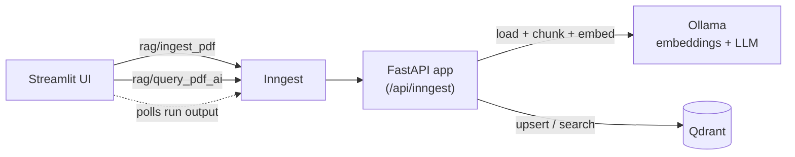

# RAG Production App

A local-first Retrieval-Augmented Generation (RAG) app for PDFs. Upload a document, ask questions in plain language, and get answers that cite the document and page they came from. Everything runs on your own machine: no API keys and no data leaving your computer.

Ingestion and querying run as **durable, retryable workflows** on [Inngest](https://www.inngest.com/), so every step is observable and failures can be retried instead of silently lost.

<!-- TODO: add a demo GIF or screenshot here, e.g.  -->

## Features

- **PDF ingestion pipeline**: load, chunk (with overlap), embed in batches, and upsert into Qdrant.
- **Page-level citations**: every chunk keeps its source file and page number, and answers cite their sources.
- **Idempotent re-ingestion**: chunk IDs are deterministic (`uuid5(source:index)`), and stale chunks are deleted when a document is re-uploaded, so you never get duplicates.
- **Relevance threshold**: low-similarity chunks are filtered out, and the app says so instead of guessing when nothing relevant is found.
- **Grounded answers**: the model is instructed to answer only from the retrieved context, cite passages like `[1]`, and say "I don't know" otherwise.
- **Workflow observability**: every ingest and query run is visible step by step in the Inngest dev dashboard.
- **Single config module**: all model names, URLs and tuning knobs live in one place and can be overridden with environment variables.

## Architecture



**Ingest flow** (`rag/ingest_pdf`)

1. `load-and-chunk`: read the PDF page by page (LlamaIndex `PDFReader`) and split with `SentenceSplitter`, keeping the page number for each chunk.
2. `embed-and-upsert`: embed chunks in batches with `nomic-embed-text`, delete any old chunks for that file, then upsert the new ones into Qdrant.

**Query flow** (`rag/query_pdf_ai`)

1. `embed-and-search`: embed the question, run a cosine search in Qdrant with a score threshold (optionally filtered to one document).
2. `llm-answer`: build a numbered, source-labelled context block and ask the LLM to answer from it with citations.

## Tech stack

| Layer | Tool |
|---|---|
| Language / packaging | Python 3.13, [uv](https://docs.astral.sh/uv/) |
| Workflow engine | [Inngest](https://www.inngest.com/) (Python SDK + dev server) |
| API | FastAPI + Uvicorn |
| PDF parsing and chunking | LlamaIndex (`PDFReader`, `SentenceSplitter`) |
| Vector database | [Qdrant](https://qdrant.tech/) |
| Embeddings | `nomic-embed-text` via [Ollama](https://ollama.com/) |
| LLM | `qwen3.5:2b` via Ollama (configurable) |
| UI | Streamlit |

## Prerequisites

- Python 3.13 and [uv](https://docs.astral.sh/uv/getting-started/installation/)
- Node.js (only to run the Inngest dev server through `npx`)
- [Docker](https://docs.docker.com/get-docker/) (for Qdrant)
- [Ollama](https://ollama.com/download)

## Quick start

```bash
git clone https://github.com/kisinja/rag-production-app.git
cd rag-production-app
uv sync
cp .env.example .env
```

Pull the models once:

```bash
ollama pull nomic-embed-text
ollama pull qwen3.5:2b
```

Then start the five services, each in its own terminal, **from the project root**:

```bash
# 1. Qdrant (vector database)
docker run -p 6333:6333 -v "$(pwd)/qdrant_storage:/qdrant/storage" qdrant/qdrant

# 2. Ollama (skip if it is already running)
ollama serve

# 3. Backend API
uv run uvicorn rag_production_app.main:app --reload --port 8000

# 4. Inngest dev server
npx inngest-cli dev -u http://127.0.0.1:8000/api/inngest --no-discovery

# 5. Streamlit UI
uv run streamlit run src/rag_production_app/streamlit_app.py
```

Open the UI at <http://localhost:8501>, upload a PDF, and ask a question. Open <http://localhost:8288> to watch the runs in the Inngest dashboard.

Check that <http://localhost:8288/apps> shows the app as **Synced** with two functions: `RAG: Inngest PDF` and `RAG: Query PDF`.

## Configuration

All settings are defined in `src/rag_production_app/config.py` and can be overridden in `.env`.

| Variable | Default | Purpose |
|---|---|---|
| `OLLAMA_BASE_URL` | `http://localhost:11434/v1` | Ollama's OpenAI-compatible endpoint |
| `LLM_MODEL` | `qwen3.5:2b` | Model used to write answers |
| `EMBED_MODEL` | `nomic-embed-text:latest` | Embedding model |
| `EMBED_DIM` | `768` | Embedding size (must match the model) |
| `QDRANT_URL` | `http://localhost:6333` | Qdrant server |
| `QDRANT_COLLECTION` | `docs` | Collection name |
| `CHUNK_SIZE` | `1000` | Chunk size in tokens |
| `CHUNK_OVERLAP` | `100` | Overlap between chunks |
| `EMBED_BATCH_SIZE` | `32` | Chunks per embedding request |
| `MIN_SCORE` | `0.3` | Minimum cosine similarity for a chunk to be used |
| `INNGEST_API_BASE` | `http://127.0.0.1:8288/v1` | Where the UI polls for run output |

If you change `EMBED_MODEL` or `EMBED_DIM`, use a new `QDRANT_COLLECTION` (or delete the old one) and re-ingest your PDFs.

## Project structure

```
src/rag_production_app/
├── config.py          # Settings (env-overridable)
├── custom_types.py    # Pydantic models for chunks, hits and step outputs
├── data_loader.py     # PDF loading, chunking, batched async embeddings
├── vector_db.py       # Qdrant wrapper: upsert, delete-by-source, filtered search
├── main.py            # FastAPI app + Inngest ingest and query functions
└── streamlit_app.py   # Upload and Q&A UI
```

## Testing

```bash
uv run pytest -q
```

The unit tests need no Ollama or Qdrant. For an end-to-end check, run the five services above, then:

1. Upload a PDF, and confirm the ingest run finishes in the Inngest dashboard.
2. Ask a question the PDF answers: you should get an answer with sources like `file.pdf, p.3`.
3. Ask something unrelated: you should get "I don't know" or a "nothing relevant found" message.
4. Upload the same PDF again: the number of points in Qdrant should not grow.

## Troubleshooting

**Inngest shows `url_not_found` / the app is "Not Synced".** The sync URL must be exactly `http://127.0.0.1:8000/api/inngest` (it ends in `inngest`, not `ingest`). Remove the bad app from the dashboard or restart the dev server with the command above.

**`Attribute "app" not found in module`.** Run Uvicorn from the project root with the full module path: `uvicorn rag_production_app.main:app`.

**The answer is empty but sources are shown.** The model likely ran out of context. Ollama's default context window is 4096 tokens, and reasoning ("thinking") models such as `qwen3.5` can spend most of it before answering. Try one of:

- Increase the window before starting Ollama, for example `export OLLAMA_CONTEXT_LENGTH=8192`.
- Retrieve fewer chunks (lower `top_k` in the UI).
- Switch to a non-reasoning model, for example `ollama pull qwen2.5:3b` and set `LLM_MODEL=qwen2.5:3b`.

**The UI says the run's output is missing.** The Inngest dev server can report a run as "Completed" slightly before its output is ready. The UI keeps polling until the output arrives or a timeout is reached.

## Known limitations and roadmap

- PDFs only; scanned (image-only) PDFs need OCR, which is not included.
- Uploaded files are passed to the backend by local path, so the UI and backend must share a filesystem. Moving to object storage is the next step for a real deployment.
- Dense (vector) search only. Hybrid search (dense plus BM25) and reranking are planned.
- No automated retrieval or answer-quality evaluation yet. An evaluation harness (hit rate, MRR, faithfulness) is planned so that chunking and retrieval changes can be measured.
- No authentication or rate limiting on the API.
- Docker Compose setup for one-command startup is planned.